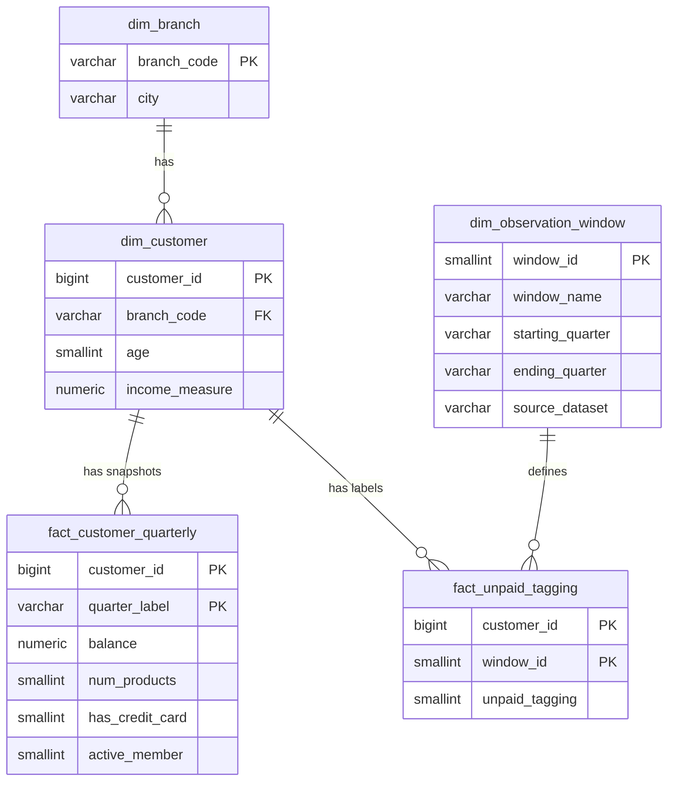

# Schema Documentation (PostgreSQL)

Database: `finanku`. Terms: *tagged* = `unpaid_tagging = 1` (definition not provided; not assumed to be default).

## Entity relationship diagram

## Tables
| Table | Grain | Rows | Notes |
|---|---|---|---|
| `stg_data_all`, `stg_data_validasi` | one row per customer per raw file | 7,561 each | Raw wide files loaded as-is; used for import and reconciliation only |
| `dim_branch` | one row per branch | 18 | `city` stored once per branch (each branch belongs to one city, verified) |
| `dim_customer` | one row per customer | 7,561 | Profile is identical in both files |
| `dim_observation_window` | one row per window | 2 | Window 1 = Data All (Q1-Q4); window 2 = Data Validasi (Q2-Q5) |
| `fact_customer_quarterly` | customer x quarter | 37,805 | Canonical Q1-Q5; Q2-Q4 verified identical in both files before being stored once |
| `fact_unpaid_tagging` | customer x window | 15,122 | Labels differ between windows, so both are kept |

## Design decisions
- **Normalization:** `city` moved to `dim_branch` (it depends on the branch, not the customer). Views join it back for reporting.
- **Branch code is a string** (`VARCHAR`), an identifier, not a measurement.
- **Quarter-level canonical table:** the overlapping Q2-Q4 snapshots are checked for equality (`02_import_data.sql`, DO block) and the load stops with an error if any difference exists; nothing is committed in that case.
- **Constraints:** primary keys, foreign keys, `CHECK` constraints (balance >= 0, binary flags in {0,1}, quarter label Q1-Q5, age > 0, income >= 0).
- **Indexes:** branch, age, quarter label and (window, tag) on top of the primary-key indexes.
- **Reusable rules:** `fn_age_group()` and `fn_income_group()` keep the same bands as the EDA notebook (income unit unconfirmed).
- **Privacy:** Power BI views are pre-aggregated and expose no `customer_id` (checked at the end of `05_create_views.sql`).

## Scripts (run from the project root, in this order)
| Script | Purpose |
|---|---|
| `01_create_tables.sql` | Drops and recreates tables, indexes and helper functions |
| `02_import_data.sql` | `\copy` CSVs into staging, overlap guard, populate dims and facts (single transaction) |
| `03_data_validation.sql` | 18 PASS/FAIL checks plus informational checks |
| `04_analysis_queries.sql` | 13 analytical queries (CTEs, window functions, FILTER aggregation) |
| `05_create_views.sql` | Views for Power BI |

## Views for Power BI
| View | Content | How to use in DAX |
|---|---|---|
| `vw_tagging_cube` | window x city x branch x age group x income group: `customers`, `tagged` | Tagging rate = `DIVIDE(SUM([tagged]), SUM([customers]))` |
| `vw_quarterly_behavior` | quarter x city x age x income: sums of balance, products, active, card, zero-balance | Averages = sum / `customers` |
| `vw_window_comparison` | start vs end of each window (additive totals) | Divide by `customers` |
| `vw_label_transitions` | tag in Data All vs Data Validasi | Matrix visual |
| `vw_branch_summary` | branch rates and rank per window | Branch page |

Never average a column of rates; always sum the counts first, then divide.

## Connecting Python (SQLAlchemy)
Credentials live in a local `.env` (copied from `.env.example`, never committed). `src/db.py` builds the engine;
`python check_db.py` confirms the connection and that SQL totals match the CSV files.
